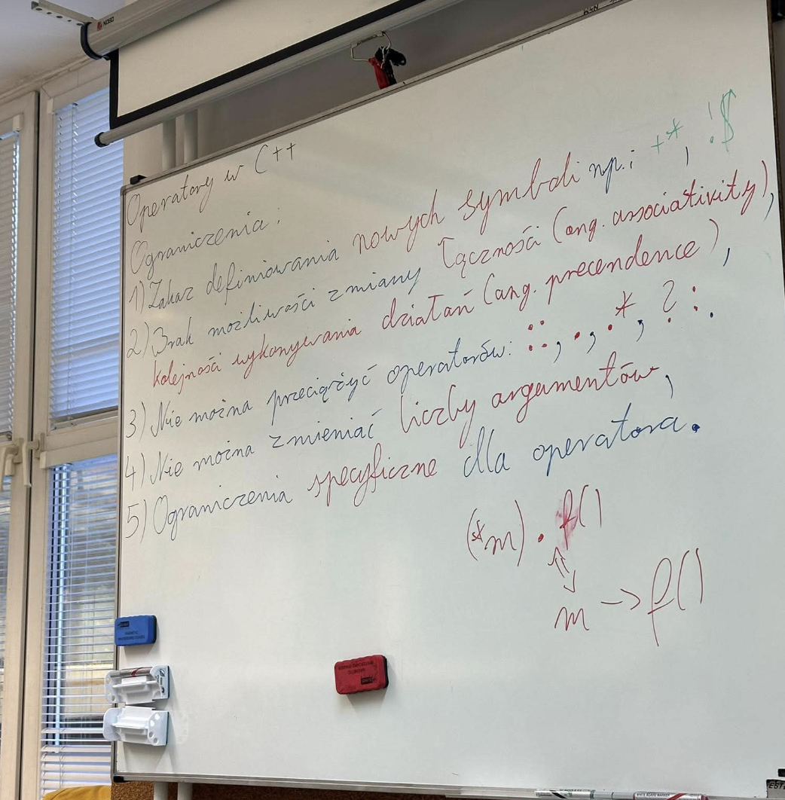
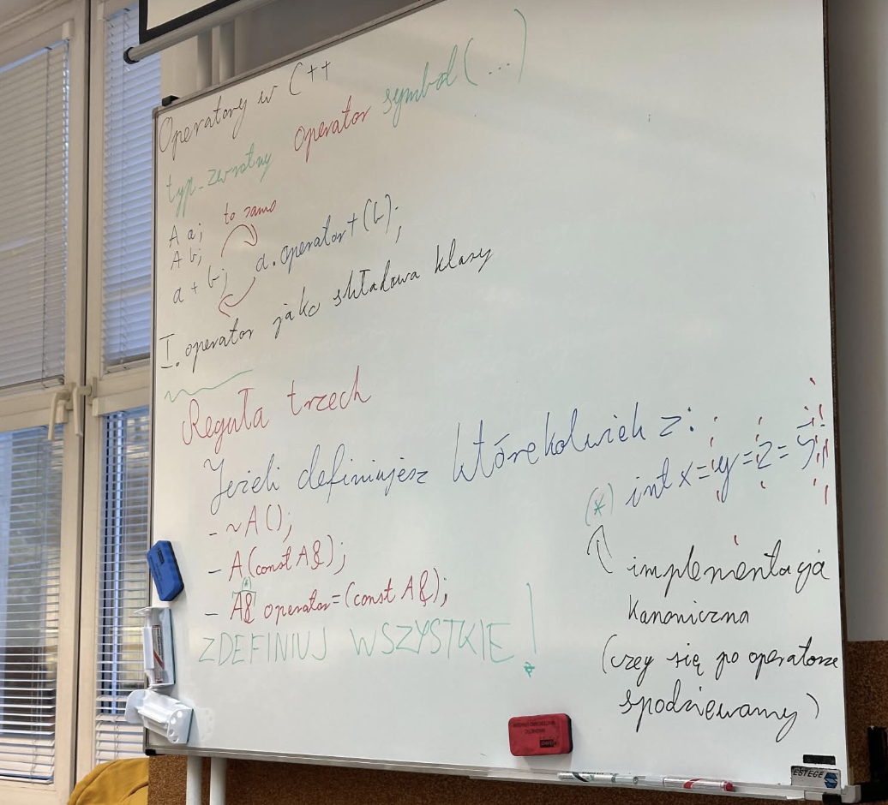

# Operatory w C++

## Ograniczenia

1) Zakaz definiowania nowych symboli np: +*, !$
2) Brak możliwości zmiany łączności (ang. associativity) i kolejności wykonywania działań (ang. precedence)
3) Nie można przeciążać operatorów: ::, ., .*, ?:
4) Nie można zmieniać liczby argumentów
5) Ograniczenia specyficzne dla operatorów



## Jak tworzyć operator

```cpp
typ_zwrotny operator symbol (...)

A a;
A b;

a + b; 
a.operator+(b); //to samo 
```

1) Operator jako składowa klasy  
**Reguła Trzech**  
Jeżeli definiujesz którekolwiek z:
    - ~A();
    - A(const A&);
    - UWAGA A& operator=(const A&);  
ZDEFINIUJ WSZYSTKIE!
UWAGA - int x = y = z = 5; - implementacja kanoniczna(czego się po operatorze spodziewamy)



```cpp
//Cells.hpp
class Cells {
    public:
        Cells(unsigned int size);
        Cells(const Cells& other);
        ~Cells();
        Cells& operator=(const Cells& other);
        int& operator[](int index);
        int operator[](int index) const;
    private:
        int* tab;
        unsigned int size;
}

//Cells.cpp
Cells::Cells(unsigned int size): 
    size(size), 
    tab(new int[this->size]) {} //pola tworza sie w kolejnosci deklaracji wiec BUM NIE DZIALA

Cells::Cells(unsigned int size): 
    size(size), 
    tab(new int[size]) {} 

Cells::Cells(const Cells& other): tab(new int[other.size]),
    size(other.size) {
        for(int i = 0; i < size; i++) {
            tab[i] = other.tab[i];
        }
}

Cells::~Cells() {
    delete[] tab;
}

Cells& Cells::operator=(const Cells& other) {
    if(this != &other) {
        return *this;
    }
    int* newTab = new int[other.size];
    for(int i = 0; i < other.size; i++) {
        newTab[i] = other.tab[i];
    }
    delete [] tab;
    size = other.size;
    tab = newTab;
    return *this;
}

//można też tak
Cells& Cells::operator=(Cells other) {
    std::swap(size, other.size);
    std::swap(tab, other.tab);
}
```
